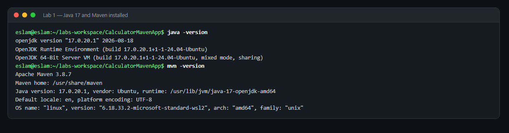
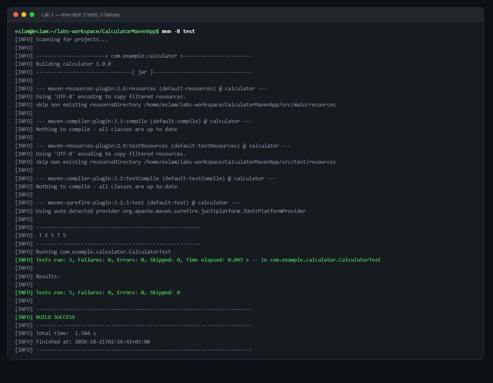
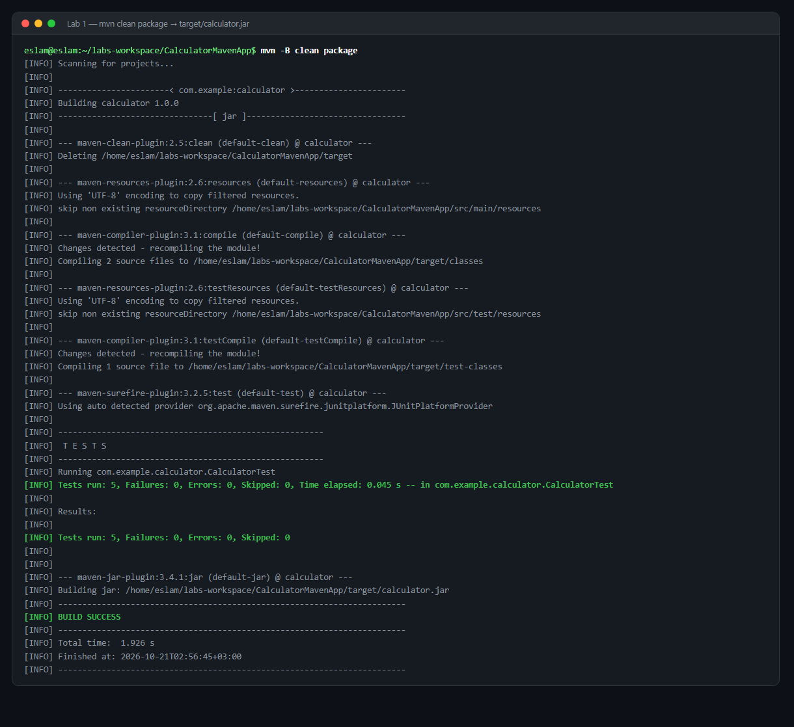
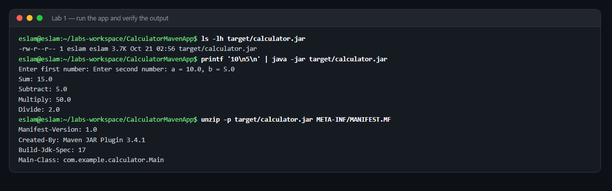

# Lab 1 — Building and Packaging a Java Application with Maven

**Track:** Build Tools · **Source:** https://github.com/Ibrahim-Adel15/CalculatorMavenApp.git

## Requirements

- [x] Install Java and Maven
- [x] Clone the source code
- [x] Run unit tests
- [x] Build the app — artifact in `target/calculator.jar`
- [x] Run the app
- [x] Verify the app is working

Full command sequence: [`commands.sh`](commands.sh)

---

## Steps and results

### 1. Install Java 17 and Maven

```bash
sudo apt update && sudo apt install -y openjdk-17-jdk maven
```

```
$ java -version
openjdk version "17.0.20.1" 2026-08-18
OpenJDK Runtime Environment (build 17.0.20.1+1-1-24.04-Ubuntu)

$ mvn -version
Apache Maven 3.8.7
Java version: 17.0.20.1, vendor: Ubuntu, runtime: /usr/lib/jvm/java-17-openjdk-amd64
```



The `Java version` line inside `mvn -version` is the one that matters — `pom.xml`
sets `maven.compiler.source` to 17, so an older JDK fails the build.

### 2. Clone the source

Cloned to `~/labs-workspace/`, **outside this repo**, so upstream code is never
committed into the submission.

```
pom.xml
src/main/java/com/example/calculator/Calculator.java
src/main/java/com/example/calculator/Main.java
src/test/java/com/example/calculator/CalculatorTest.java
```

Four files — one 60-line `pom.xml` drives the whole build.

### 3. Run the unit tests

```bash
mvn -B test
```

```
[INFO] Tests run: 5, Failures: 0, Errors: 0, Skipped: 0, Time elapsed: 0.060 s
[INFO] BUILD SUCCESS
```



**5 tests, all passing.** One of them asserts that dividing by zero throws
`ArithmeticException` — the suite covers the error path, not just the happy path.

### 4. Build the artifact

```bash
mvn -B clean package
```

```
[INFO] Tests run: 5, Failures: 0, Errors: 0, Skipped: 0
[INFO] BUILD SUCCESS
[INFO] Total time:  2.199 s
[INFO] Finished at: 2026-10-20T23:16:17+03:00

$ ls -lh target/calculator.jar
-rw-r--r-- 1 eslam eslam 3.7K Oct 20 23:16 target/calculator.jar
```



Required path and name hit exactly: **`target/calculator.jar`**, 3.7 KB.

### 5–6. Run and verify

```bash
printf '10\n5\n' | java -jar target/calculator.jar
```

```
Enter first number: Enter second number: a = 10.0, b = 5.0
Sum: 15.0
Subtract: 5.0
Multiply: 50.0
Divide: 2.0
```



Correct for 10 and 5. Both prompts appear on one line because stdin was piped —
nothing paused for a human. Interactively (`java -jar target/calculator.jar`) the
prompts appear one at a time.

---

## Why it works

**Why `java -jar` runs at all.** A `.jar` is a ZIP file. The JVM only knows where
to start because the manifest names an entry point:

```
$ unzip -p target/calculator.jar META-INF/MANIFEST.MF
Manifest-Version: 1.0
Created-By: Maven JAR Plugin 3.4.1
Build-Jdk-Spec: 17
Main-Class: com.example.calculator.Main
```

That `Main-Class` line is written by the `maven-jar-plugin` block in `pom.xml`.
Remove it and you get `no main manifest attribute`.

**Why the file is `calculator.jar`.** Maven's default output name is
`artifactId-version.jar` → `calculator-1.0.0.jar`. The lab demands the shorter
name, and `<finalName>calculator</finalName>` in `pom.xml` overrides the default.

**Why `mvn package` also ran the tests.** Maven's phases are cumulative:
validate → compile → **test** → package. Naming one runs every phase before it.
If a test fails, packaging never happens — Maven refuses to produce a broken
artifact. That behaviour is the foundation of CI.

**Where JUnit came from.** It was never downloaded by hand. `pom.xml` declares it
with `<scope>test</scope>`, so Maven fetched it from Maven Central and put it on
the *test* classpath only — deliberately absent at runtime, because shipping a
test framework to production is waste.

---

## Evidence

Terminal output from real runs of these commands on this machine, rendered as terminal-style images. **These are not raw screen captures** — they were generated from [`evidence/lab1-terminal.log`](evidence/lab1-terminal.log), and the prompt lines and colours were added by the rendering script. The images come from a later run than the output blocks above, so timestamps and durations differ slightly; the results (tests, file sizes, program output) are identical.

| # | What it proves | Screenshot |
|:-:|---|---|
| 1 | Java **17** and Maven installed | [lab1-1-toolchain.png](evidence/lab1-1-toolchain.png) |
| 2 | `mvn test` — **5 tests, 0 failures, 0 errors** | [lab1-2-unit-tests.png](evidence/lab1-2-unit-tests.png) |
| 3 | `mvn clean package` → **`target/calculator.jar`** built, `BUILD SUCCESS` | [lab1-3-build.png](evidence/lab1-3-build.png) |
| 4 | App runs and prints correct maths; manifest names `Main-Class` | [lab1-4-run-verify.png](evidence/lab1-4-run-verify.png) |

---

## Commit this lab

```bash
cd ~/iVolve-Tasks && git status
```

```bash
cd ~/iVolve-Tasks && git add "Build Tools/Lab1" && git commit -m "feat(lab1): build and package Calculator with Maven" && git push
```
